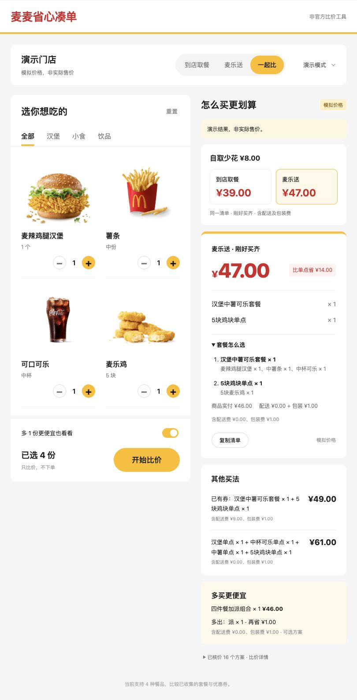

# 麦麦省心凑单

**你决定吃什么，我们帮你算怎么买。**

想吃一个汉堡、一份中薯、一杯可乐和一份鸡块，却不想逐个翻套餐？本项目将目标食品拆成可比较的购买组合，对比单点、套餐补单和已有券，分别支持到店自取与外送。最终排名依据官方整单应付金额；多买食品单独列出。

> 当前版本已在北京海淀镇餐厅完成真实 MCP 验证：自取6个方案、外送5个方案通过官方整单计价。未创建订单。下方模拟演示与真实测试记录分别标注；历史报价不代表当前价格。

## 30 秒试用

```sh
python3 web/server.py
```

打开 http://127.0.0.1:8765 ，保留默认四种食品各一份，选 **一起比 → 开始比价**。无需 Token，演示模式不访问账号。

1. 自取显示 ¥39、外送显示 ¥47（均为模拟价格），看清同一清单的到手价差。
2. 点击“麦乐送”：最省钱的刚好买齐方案变成普通套餐补鸡块，不能照搬自取的优惠券方案。
3. 展开“套餐怎么选”：核对汉堡、中薯、中可乐各一份，再补5块鸡块。
4. 开启多买：外送多一个派的模拟组合为 ¥46，额外食品单列；关掉多买后只保留刚好买齐。

这也是本项目的重点：**清单不变、两种方式独立核价、把套餐拆明白**。实时模式需要先准备本人账号的本机配置，见下文。

## 目标用户

已经决定要吃什么、不想遍历套餐和优惠券的个人用户及一起点餐的小组。需要的是“把清单买齐的买法”，而不是随机推荐菜单。

## 可操作的网页版



截图中的演示结果为模拟价格。餐品图片使用麦当劳 MCP 返回的官方菜单图片地址，图片权利归原权利人，不适用本项目代码的 MIT 许可。

启动：`python3 web/server.py`，然后打开 **http://127.0.0.1:8765**。Mac 也可运行 `bash 打开网页版.command`。

- 直接调整四种餐品的数量（每种0–2份），切换自取、外送或“一起比”，选择严格买齐或最多多1份。
- “一起比”用同一份食品清单，分别查询两种方式的菜单、券和整单费用，展示含费用的价差；点击任一方式查看详细买法。某一方式查询失败时保留另一方式结果，不补造价格。
- 展开“套餐怎么选”可看到每个套餐的具体组成、数量、是否使用已有券，以及商品实付和配送/包装费用；复制清单也包含这些组成。
- 比较结果展示套餐补单清单、总额、相比单点的节省额以及已包含的配送/包装费；可以复制购买清单。
- 默认模拟演示，不需要登录；所有模拟金额均明确标注为虚构。
- 真实查询使用本机 Token 和 `private/pickup-snapshot.json`、`private/delivery-snapshot.json` 中已配置的门店及套餐范围。请先让助手按 `skills/mcd-smart-basket/references/live-workflow.md` 准备快照；外送还需该次已授权地址查询的 `private/addresses-response.json`。这些账号文件不随仓库发布。
- 每轮重新读取官方菜单、可用券和套餐详情，再对最多10个候选调用官方整单计价；没有用旧报价冒充实时价格。外送先核对已绑定地址仍存在、门店仍匹配。每轮只核对已收集的套餐配置，不扫描全店。
- 网页首版使用北京海淀镇餐厅的已验证设置，支持麦辣鸡腿汉堡、中薯、中可乐、5块麦乐鸡；尚未提供自由搜索门店、任意餐品和特调编辑。
- 服务仅监听本机。浏览器只收到脱敏结果；Token、券码、详细地址和原始请求留在本机。跨站请求及非本机 Host 被拒绝。此版本不是公网托管网站。

## 怎么用

项目包含本机网页版和供 AI 助手使用的 Skill，均使用同一套 Python 比价逻辑。

1. 下载仓库，准备 Python 3.10 或更新版本，无第三方 Python 依赖。
2. 将 `skills/mcd-smart-basket` 整个文件夹导入支持 `SKILL.md` 的 AI 客户端的技能目录；具体导入方式以该客户端为准。也可以让有文件执行能力的助手读取该文件后执行流程。
3. 在 [麦当劳 MCP 官方平台](https://open.mcd.cn/mcp) 激活个人 Token，仅保存在本机，然后连接官方 MCP。`mcp-config.example.json` 只提供环境变量占位符示例，各客户端替换语法可能不同。
4. 对助手说：

   > 我想要一个巨无霸、一份中薯、一杯中杯可乐和一份5块麦乐鸡。帮我比较附近门店到店自取和这个已有地址的外送买法，刚好买齐优先；可以另外看看多一件能不能更便宜。

5. 助手确认位置/规格后查询真实数据，运行候选计算，再调用官方整单计价，给出方案。不会下单或付款。

尚未开通 MCP 也可以直接看离线演示：

```sh
python3 examples/demo.py
```

Mac 上可运行 `bash 查看演示.command`。网页上传的脚本可能没有执行权限；需要双击时，先运行 `chmod +x 查看演示.command 连接麦当劳.command`。已有演示输出见 [demo-results.txt](examples/demo-results.txt)。

开通 Token 后，Mac 用户可运行 `bash 连接麦当劳.command`，在终端隐藏输入 Token；验证成功后保存在本项目 `private/mcd-token`，仅当前用户可读写，不进入 Git。命令行等价入口是 `python3 skills/mcd-smart-basket/scripts/mcp_readonly.py setup`。该文件供后续查询脚本自动读取；删除它即可移除本地保存的凭据。

## 演示结果

以下为**完全虚构的模拟数据**，专门演示配送费如何改变最便宜的买法：

| 方案 | 到店自取 | 外送（含费用） |
| --- | ---: | ---: |
| 全部单点 | ¥60.00 | ¥61.00 |
| 普通套餐＋鸡块 | ¥46.00 | **¥47.00** |
| 已有券套餐＋鸡块 | **¥39.00** | ¥49.00 |
| 多一个派的组合 | ¥45.00 | ¥46.00 |

到店时已有券套餐最便宜；外送时普通套餐因模拟配送减免规则更划算。多一个派的组合在外送时再省 ¥1，但属于额外食品，单独展示供用户选择。程序不会把“多买”伪装成完全相同的清单。

## 真实测试：北京海淀镇餐厅

2026-10-16，清单为麦辣鸡腿汉堡、中薯条、中杯可乐、5块麦乐鸡各一份。各方式独立查询菜单和两张已有券，按官方整单结果比较：

| 刚好买齐的买法 | 自取实付 | 外送实付（含费用） |
| --- | ---: | ---: |
| 全部单点 | ¥61.00 | ¥76.20 |
| 汉堡套餐＋5块麦乐鸡 | **¥47.50** | **¥65.20** |
| 麦乐鸡套餐＋汉堡 | **¥47.50** | ¥65.50 |
| 已有券小食拼（中薯＋中可乐）＋汉堡＋5块麦乐鸡 | ¥52.40 | ¥65.90 |

这次已核价方案中，自取省 ¥13.50，外送省 ¥11.00。外送两种套餐补单的商品小计相同，但包装费不同，导致总价相差 ¥0.30。部分展示促销价并未成为本次整单结算价，所以不能仅用菜单价格推荐。

四件套含4块麦乐鸡，不能冒充目标清单的5块；补5块后属于多买4块的另一方案。买一送一薯条券也会多出一份，单独计算，不偷偷改动需求。本轮多买方案没有优于刚好买齐的方案。

范围：自取生成14个候选、核价6个；外送生成13个候选、核价5个。只覆盖已收集的相关套餐配置、现有券和单笔订单，并非全店绝对最低价。所有4种“刚好买齐”候选均完成核价。原始请求/响应保存在本机；公开材料去除了 Token、地址、电话、券码和用户标识。官方报价会回显主商品编号和数量，不逐项回显套餐子项；子项按原始请求与官方详情绑定。

[自取测试记录](examples/live-pickup-results.txt) · [外送测试记录](examples/live-delivery-results.txt) · [脱敏计价证据](examples/live-price-evidence.json)

## 已实现

- 用整数“分”计算金额，枚举单点和固定配置套餐的组合。
- 保留食品身份、规格和数量；同一券的多个配置共享库存，支持已知互斥规则。
- 刚好买齐与允许多买的方案分开展示。
- 两种用餐方式分别生成快照、核价和排序；外送以已包含配送/包装费的总额比较。
- 重验导入购物车、防止跨门店/方式/地址/时间错用报价，拒绝模拟与真实数据混用。
- 展示搜索上限、未核价数量和失效报价；没有单点核价就不计算节省额。
- 附带只读 MCP 调试客户端，支持工具发现、分页和 JSON/SSE，禁止下单等写操作。

## 接入与局限

真实查询流程见 [MCP_INTEGRATION.md](MCP_INTEGRATION.md)。官方工具的实际参数和返回结构需在认证后发现，餐品和套餐配置仍由 AI 助手整理；新增 mcd_adapter.py 与 quote_live.py 按实测 schema 构造请求、核对回显商品数量和费用总额。不能直接把本地计算 JSON 发给官方接口。

比较范围受已获取菜单、套餐配置、券、数量上限和核价次数约束，所以只称“已比较且核价成功方案中最便宜”。单笔订单为本版范围；不跨店拆单，不购买新会员卡，不兑换积分券，不假设第三方渠道优惠。即使某券看上去可用，官方计价拒绝后也必须移除该方案。

## 测试

```sh
python3 -m unittest discover -s tests -v
```

测试覆盖配送费导致的排序反转、重复券、规格保持、互斥、报价过期、上下文绑定、篡改购物车、搜索截断，以及40组随机小菜单与独立暴力枚举的结果一致性。共49项本地测试通过，此前另有11个真实官方整单报价验证；本轮网页“一起比”又分别完成自取6个、外送6个报价验证，见 VALIDATION.md。

## 参赛准备

参赛账号：`3398313087-ux`。公开仓库：[mcd-smart-basket](https://github.com/3398313087-ux/mcd-smart-basket)。

本仓库包含 README、MCP 接入说明、环境变量配置示例、源代码和官方原样参赛声明。`SUBMISSION.md` 是发布与报名草稿，不表示已报名。未使用 WorkBuddy，因此未生成 `workbuddy.md` 或声称符合其专项奖励。

官方来源：[比赛仓库](https://github.com/M-China/mcd-developer-innovation-challenge) · [活动规则](https://github.com/M-China/mcd-developer-innovation-challenge/blob/main/activityGuidelines.md) · [MCP 接入指南](https://github.com/M-China/mcd-mcp-server)。

本项目为个人开发的非官方作品。参赛声明保持官方原文；项目原创代码采用 MIT License，官方声明不因该代码许可而改变。
